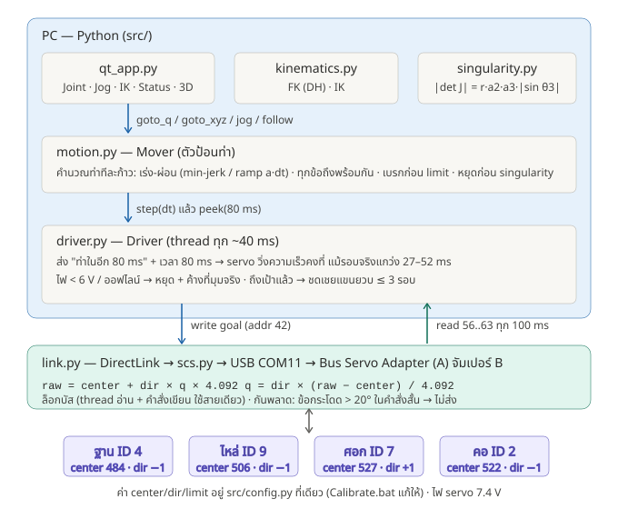
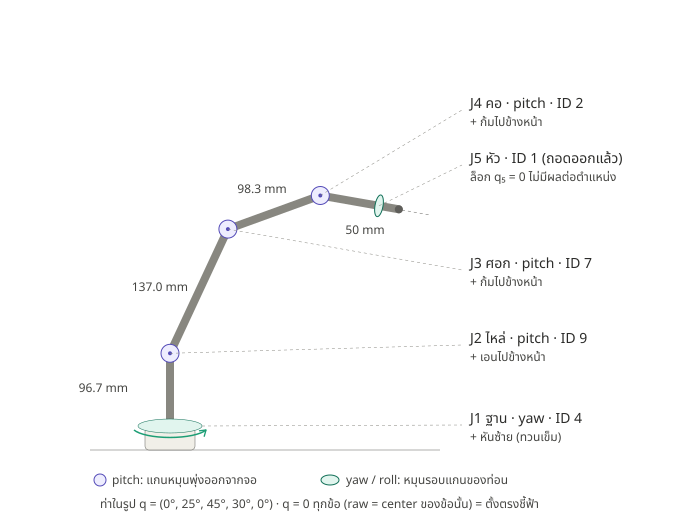
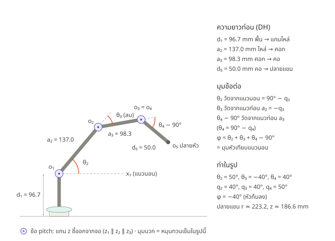
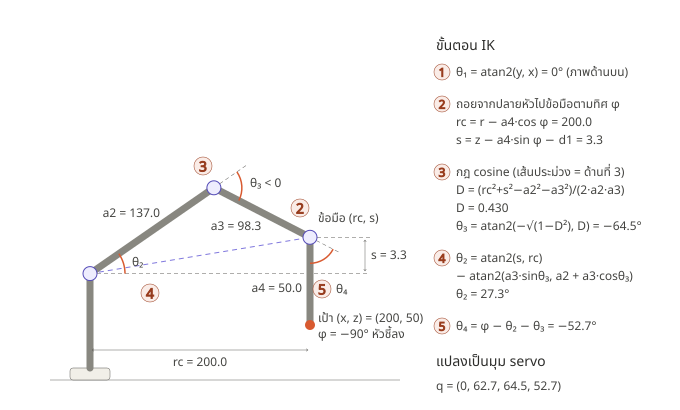
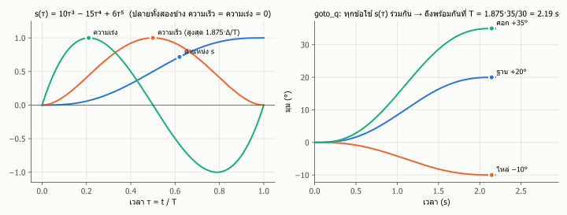
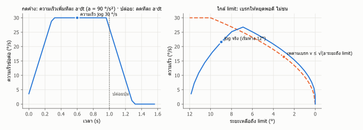
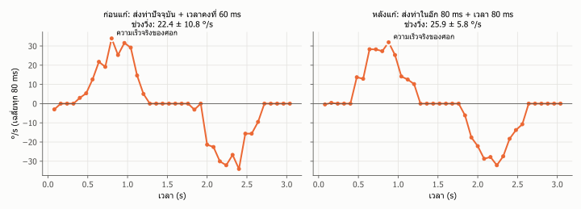
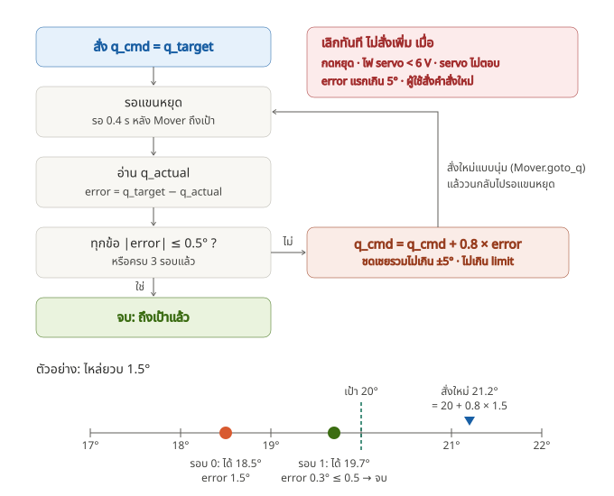
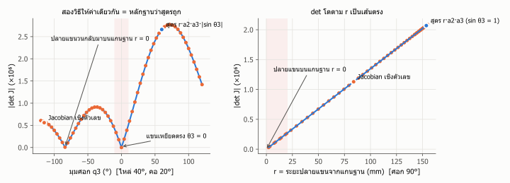

# อธิบายการคำนวณ — RobotArmSmooth (แขน 4 ข้อ, PC คุม servo ตรง)

รูปกราฟสร้างจากโค้ดจริงด้วย `docs/make_charts.py` (แก้สูตรแล้วรันใหม่ได้) · รูปแขน FK/IK มาจาก RobotControl `v2/docs` (d5 = 50 mm แล้ว)

## 1. ภาพรวม: ข้อมูลไหลจากหน้าต่างไปถึง servo



| ไฟล์ | หน้าที่ |
|---|---|
| `qt_app.py` | หน้าต่าง (Joint · Jog · IK · Status · 3D) |
| `motion.py` | **ตัวป้อนท่า** คำนวณท่าถัดไปทีละก้าว (ข้อ 4–5) |
| `driver.py` | thread ส่งท่าให้แขน + ความปลอดภัย + ชดเชย (ข้อ 6–7) |
| `link.py` / `scs.py` | แปลง q ↔ raw แล้วส่ง packet SCS ผ่าน COM11 |
| `kinematics.py` / `singularity.py` | FK, IK (ข้อ 2–3) · ตรวจ singularity (ข้อ 8) |

## 2. Forward Kinematics: มุมข้อต่อ → ตำแหน่งปลายแขน





- ตาราง DH: d1 = 96.7, a2 = 137.0, a3 = 98.3, **d5 = 50** mm (J5 หัวถอดแล้ว → q5 = 0)
- `T⁰₅ = A₁A₂A₃A₄A₅` → คอลัมน์ที่ 4 = ตำแหน่ง (x, y, z) · φ = θ2 + θ3 + θ4 − 90° (มุมปลายแขนเทียบแนวนอน)

## 3. Inverse Kinematics: ตำแหน่ง → มุมข้อต่อ



1. θ1 = atan2(y, x) · 2. ถอยจากปลายแขนไปข้อมือตามทิศ φ · 3. กฎ cosine หา θ3 · 4. θ2 · 5. θ4 = φ − θ2 − θ3 + 90°
- **φ ที่ใส่ไปไม่ได้** (ตำแหน่งถึงแต่มุมไม่ถึง) → หน้าต่างหา φ ที่ใกล้ที่สุดที่ไปได้ (ทีละ 1°) แล้วบอกใน Log

## 4. เคลื่อนที่นุ่ม: โปรไฟล์ min-jerk (`Mover.goto_q`)



- **s(τ) = 10τ³ − 15τ⁴ + 6τ⁵**, τ = t / T → เริ่มและจบด้วยความเร็ว = ความเร่ง = 0 (ไม่กระตุกตอนออกตัว/หยุด)
- ทุกข้อใช้ s(τ) ตัวเดียวกัน: q(t) = q₀ + (q₁ − q₀)·s(t/T) → **ถึงพร้อมกัน**
- เวลา **T = 1.875 · Δ_max / v** (ความเร็วสูงสุดของ s คือ 1.875 ที่ τ = 0.5) · v = 150 °/s
- ไปจุด X Y Z แบบเส้นตรง (`goto_xyz`): แบ่งเส้นทุก 1 mm แล้วทำ IK ทุกจุด ใช้ s(τ) เดียวกัน

## 5. Jog: กดค้าง / ปล่อย / เบรกก่อน limit



- ความเร็วเปลี่ยนได้ไม่เกิน **a·dt** ต่อก้าว (a = 90 °/s², jog 30 °/s, ปลายแขน 40 mm/s) · ปล่อยปุ่ม: ผ่อนด้วย **0.5·a** (ผ่อนเต็ม a แขนเด้ง) แล้วชดเชยแขนยวบที่ท่าที่หยุด
- ใกล้ limit: เพดาน **v ≤ √(a · ระยะถึง limit)** → ผ่อนจนชน limit ช้า ๆ (เดิมใช้ √(2a·ระยะ) ตัวผ่อนตามไม่ทัน ชนที่ ~14 °/s)
- jog ปลายแขน: ปลาย += v·dt แล้ว IK · ถ้าข้อต้องหมุนเร็วเกินที่ตั้ง → ลดความเร็วปลายแขนลงแทนการหยุด

## 6. ส่งท่าล่วงหน้า 80 ms (`Mover.peek`) — แก้ jog กระตุก



- วัดจริง: thread ที่ตั้งไว้ 40 ms บน Windows วนจริง **27–52 ms**
- เดิม: ส่ง "ท่าตอนนี้" + เวลาคงที่ 60 ms → ระยะแต่ละก้าวยาวสั้นตามรอบ → ความเร็ว servo แกว่ง ±30%
- ใหม่: ส่ง **ท่าในอีก 80 ms** + เวลา 80 ms → ความเร็ว servo = (เป้า − ตอนนี้) / 80 ms = v เสมอ
- ผลวัดศอก jog 30 °/s: แกว่ง ±10.8 → **±5.8 °/s**, ตามหลัง 4.4° → **2.5°**

## 7. ชดเชยแขนยวบหลังถึงเป้า (`Driver._correction`)



error = q_target − q_actual → ข้อที่ |error| > 0.5° สั่ง q_target + 0.8·error (แบบนุ่ม) ≤ 3 รอบ, รวม ≤ ±5° · error แรก > 5° = ไปไม่ถึงเลย ไม่ชดเชย

## 8. Singularity: ท่าที่ปลายแขนเสียทิศขยับ (`singularity.py`)




- **|det J| = r · a2 · a3 · |sin θ3|** → = 0 เมื่อปลายแขนอยู่บนแกนฐาน (r = 0) หรือแขนเหยียด/พับสุด (θ3 = 0°/180°)
- หลักฐาน: คิด J เชิงตัวเลข (ขยับทีละข้อ 0.001°) แล้วหา det → **เท่ากับสูตรทุกท่า** (กราฟซ้าย, test สุ่ม 300 ท่า)
- หน้าต่าง: กล่องขวาของ Forward Kinematics แสดง det สองทาง + σ_min · แดง = ใกล้ singularity · jog ปลายแขนหยุดก่อนเข้า

## 9. มุม q ↔ raw ของ servo (`config.py`)

```
raw = center + dir × q × 4.092        (1023 tick / 250° = 4.092 tick/°)
q   = dir × (raw − center) / 4.092
```
center = raw ตอนท่อนตั้งตรง · dir = +1/−1 ให้ q บวก = ก้มหน้า / ฐานหันซ้าย · คาลิเบรตใหม่: `Calibrate.bat`
