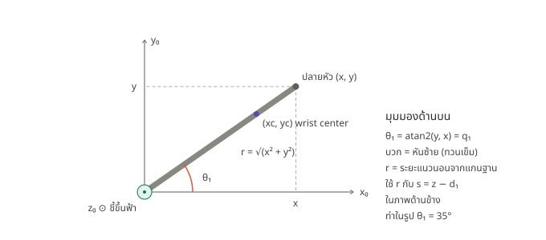
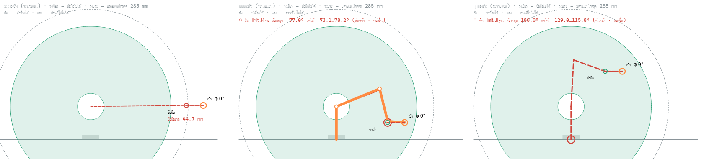
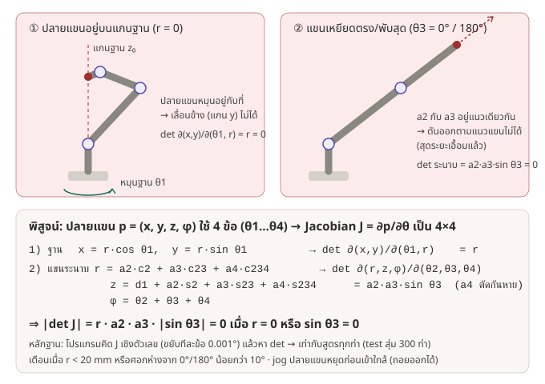

# อธิบายการคำนวณ — RobotArmSmooth (แขน 4 ข้อ: ฐาน ไหล่ ศอก คอ, PC คุม servo ตรง)

รูปกราฟสร้างจากโค้ดจริงด้วย `docs/make_charts.py` (แก้สูตรแล้วรันใหม่ได้) · รูปแขน FK/IK ดัดแปลงจาก RobotControl `v2/docs` เป็นตาราง DH 4 แถว

## 1. ภาพรวม: ข้อมูลไหลจากหน้าต่างไปถึง servo


| ไฟล์ | หน้าที่ |
|---|---|
| `qt_app.py` | หน้าต่าง (Joint · Jog · IK · Status · 3D) |
| `motion.py` | **ตัวป้อนท่า** คำนวณท่าถัดไปทีละก้าว (ข้อ 4–5) |
| `driver.py` | thread ส่งท่าให้แขน + ความปลอดภัย + ชดเชย (ข้อ 6–7) |
| `link.py` / `scs.py` | แปลง q ↔ raw แล้วส่ง packet SCS ผ่าน COM11 |
| `kinematics.py` / `singularity.py` | FK, IK (ข้อ 2–3) · ตรวจ singularity (ข้อ 8) |
| `ik_explain.py` / `ik_sketch.py` | เหตุผลที่ IK ไปไม่ได้ + รูปในแท็บ IK (ข้อ 3.1) |

## 2. Forward Kinematics: มุมข้อต่อ → ตำแหน่งปลายแขน




- ตาราง DH 4 แถว (ถอด servo หัว J5 ออกแล้ว → ท่อนคอถึงปลายแขนเป็นท่อนตรงยาว **a4 = 50 mm**):

| Link | a (mm) | α | d (mm) | θ |
|---|---|---|---|---|
| 1 ฐาน | 0 | 90° | 96.7 | θ₁ |
| 2 ไหล่ | 137.0 | 0 | 0 | θ₂ |
| 3 ศอก | 98.3 | 0 | 0 | θ₃ |
| 4 คอ | 50.0 | 0 | 0 | θ₄ |
- มุม servo q (0 = ตั้งตรง) ไม่ใช่มุม DH θ → แปลงก่อนเข้าสมการ (`q_to_theta` ที่เดียว):

| ข้อ | θ (DH) | เหตุผล |
|---|---|---|
| J1 ฐาน | θ₁ = q₁ | ฐานบวกทวนเข็ม = θ บวกรอบ z₀ |
| J2 ไหล่ | θ₂ = 90° − q₂ | θ₂ วัดจากแนวนอน · ตั้งตรง = 90° |
| J3 ศอก | θ₃ = −q₃ | ศอกก้มหน้า (q บวก) = หมุนตามเข็มในระนาบแขน |
| J4 คอ | θ₄ = −q₄ | คอก้มหน้า = หมุนตามเข็มเหมือนศอก |

- `T⁰₄ = A₁A₂A₃A₄` → คอลัมน์ที่ 4 = ตำแหน่ง (x, y, z) · **φ = θ2 + θ3 + θ4** (มุมปลายแขนเทียบแนวนอน — แกนไหล่ ศอก คอ ขนานกัน มุมจึงบวกกันตรง ๆ)
- ตาราง 4 แถวให้ปลายแขนตรงกับตาราง 5 แถวเดิม (α₄ = 90°, d5 = 50, θ₅ = 0) ทุกท่า — มี test ตรวจ 300 ท่า

### 2.1 ตาราง Homogeneous Transformation (ทีละข้อ)

เมทริกซ์ของแต่ละ Link (สไลด์ FK) แล้วคูณต่อกัน **T⁰ᵢ = T⁰ᵢ₋₁ · Aᵢ** (โค้ด: `dh_matrix`, `forward_kinematics`)

```
       ┌ cθᵢ  −sθᵢ·cαᵢ   sθᵢ·sαᵢ   aᵢ·cθᵢ ┐
Aᵢ  =  │ sθᵢ   cθᵢ·cαᵢ  −cθᵢ·sαᵢ   aᵢ·sθᵢ │   = Rot(z,θᵢ) · Trans(z,dᵢ) · Trans(x,aᵢ) · Rot(x,αᵢ)
       │ 0     sαᵢ       cαᵢ       dᵢ     │
       └ 0     0         0         1      ┘
```

| Link | θᵢ | dᵢ (mm) | aᵢ (mm) | αᵢ | Aᵢ ทำอะไร |
|---|---|---|---|---|---|
| 1 ฐาน | θ₁ = q₁ | 96.7 | 0 | 90° | หมุนรอบแกนตั้ง → ยกขึ้น 96.7 → พับแกน z ให้นอน (แกนไหล่) |
| 2 ไหล่ | θ₂ = 90° − q₂ | 0 | 137.0 | 0 | หมุนในระนาบแขน → ยื่นไป 137.0 |
| 3 ศอก | θ₃ = −q₃ | 0 | 98.3 | 0 | หมุนในระนาบแขน → ยื่นไป 98.3 |
| 4 คอ | θ₄ = −q₄ | 0 | 50.0 | 0 | หมุนในระนาบแขน → ยื่นไป 50.0 ถึงปลายแขน |

แทนค่าแล้วคูณ (ข้อ 2–4 หมุนในระนาบเดียวกัน จึงรวมมุมกันได้):

```
      ┌ c1  0   s1   0  ┐         ┌ c2  −s2  0  a2·c2 ┐         ┌ c3  −s3  0  a3·c3 ┐         ┌ c4  −s4  0  a4·c4 ┐
A1 =  │ s1  0  −c1   0  │   A2 =  │ s2   c2  0  a2·s2 │   A3 =  │ s3   c3  0  a3·s3 │   A4 =  │ s4   c4  0  a4·s4 │
      │ 0   1   0    d1 │         │ 0    0   1  0     │         │ 0    0   1  0     │         │ 0    0   1  0     │
      └ 0   0   0    1  ┘         └ 0    0   0  1     ┘         └ 0    0   0  1     ┘         └ 0    0   0  1     ┘

         ┌ c1·c234  −c1·s234   s1   c1·R  ┐      R = a2·c2 + a3·c23 + a4·c234   (ระยะแนวนอนจากแกนฐาน)
T⁰₄  =   │ s1·c234  −s1·s234  −c1   s1·R  │      Z = a2·s2 + a3·s23 + a4·s234   (สูงจากแกนไหล่)
         │ s234      c234      0    d1+Z  │      ci = cos θi,  c23 = cos(θ2+θ3),  c234 = cos(θ2+θ3+θ4) = cos φ
         └ 0         0         0    1     ┘
```

**ตัวอย่างตัวเลข** q = (30°, 40°, 40°, 50°) → θ = (30°, 50°, −40°, −50°) (คำนวณจากโค้ดจริง):

```
A1 (θ1 = 30°)                     A2 (θ2 = 50°)                     A3 (θ3 = −40°)                    A4 (θ4 = −50°)
┌ 0.866  0      0.500   0    ┐    ┌ 0.643 −0.766  0   88.1 ┐      ┌  0.766  0.643  0   75.3 ┐      ┌  0.643  0.766  0   32.1 ┐
│ 0.500  0     −0.866   0    │    │ 0.766  0.643  0  104.9 │      │ −0.643  0.766  0  −63.2 │      │ −0.766  0.643  0  −38.3 │
│ 0      1      0      96.7  │    │ 0      0      1    0   │      │  0      0      1    0   │      │  0      0      1    0   │
└ 0      0      0       1    ┘    └ 0      0      0    1   ┘      └  0      0      0    1   ┘      └  0      0      0    1   ┘

T⁰₂ = A1·A2                       T⁰₃ = T⁰₂·A3                      T⁰₄ = T⁰₃·A4
┌ 0.557 −0.663  0.500   76.3 ┐    ┌ 0.853 −0.150  0.500  160.1 ┐    ┌  0.663  0.557  0.500  193.3 ┐
│ 0.321 −0.383 −0.866   44.0 │    │ 0.492 −0.087 −0.866   92.4 │    │  0.383  0.321 −0.866  111.6 │
│ 0.766  0.643  0      201.6 │    │ 0.174  0.985  0      218.7 │    │ −0.643  0.766  0      186.6 │
└ 0      0      0        1   ┘    └ 0      0      0        1   ┘    └  0      0      0        1   ┘
```

| จุด | คอลัมน์ที่ 4 ของ | x (mm) | y (mm) | z (mm) |
|---|---|---|---|---|
| o₁ แกนไหล่ | T⁰₁ | 0 | 0 | 96.7 |
| o₂ ศอก | T⁰₂ | 76.3 | 44.0 | 201.6 |
| o₃ คอ | T⁰₃ | 160.1 | 92.4 | 218.7 |
| **o₄ ปลายแขน** | **T⁰₄** | **193.3** | **111.6** | **186.6** |

- ตรวจ: R = √(193.3² + 111.6²) = 223.2 mm, Z = 186.6 − 96.7 = 89.9 mm · φ = 50 − 40 − 50 = **−40°** (ตรงกับรูปมุมมองข้าง)
- คอลัมน์ที่ 1 ของ T⁰₄ = ทิศที่ปลายแขนชี้ (x₄) · คอลัมน์ที่ 3 = แกนหมุนของข้อ pitch (z₁ = z₂ = z₃ ขนานกัน) · มี test ตรวจว่าสูตร T⁰₄ ข้างบนเท่ากับโค้ดทุกท่า

## 3. Inverse Kinematics: ตำแหน่ง → มุมข้อต่อ


1. θ1 = atan2(y, x) · 2. ถอยจากปลายแขนไปข้อมือตามทิศ φ · 3. กฎ cosine หา θ3 · 4. θ2 · 5. θ4 = φ − θ2 − θ3
- **ใกล้แกนฐาน** (r < 30 mm): ใช้คำตอบที่สองของสไลด์ θ1 + 180° กับ r ติดลบ (เอนไปข้างหลังแทนหมุนฐาน) ถ้าใกล้มุมฐานเดิมกว่า — ไม่งั้นปลายแขนเลยหลังแกน 0.2 mm atan2 กระโดดเป็น 180° (ฐานเกิน limit, เจอตอน jog Z− จากท่าตั้งตรง)
- **φ ที่ใส่ไปไม่ได้** (ตำแหน่งถึงแต่มุมไม่ถึง) → หน้าต่างหา φ ที่ใกล้ที่สุดที่ไปได้ (ทีละ 1°) แล้วบอกใน Log

### 3.1 ทำไมไปจุดที่ใส่ไม่ได้ (แท็บ IK แสดงเอง — `ik_explain.py`, `ik_sketch.py`)



กด Preview / Go แล้วหน้าต่างไล่ตรวจตามขั้น IK และวาดรูปมุมมองข้าง (วงเขียว = ที่ที่ข้อมือไปได้, แดง = ส่วนที่ไปไม่ได้):

| ตรวจ | ไปไม่ได้เมื่อ | ตัวอย่างข้อความ |
|---|---|---|
| ปลายแขนไกลจากแกนไหล่ | > a2 + a3 + a4 = 285.3 mm | ไกลเกินไป … ขาด 44.7 mm → ขยับเป้าเข้าหาแกนไหล่ |
| ข้อมือ (ถอยจากเป้า a4 ตามทิศ φ) | ห่างไหล่นอกช่วง \|a2 − a3\| … a2 + a3 = 38.7 … 235.3 mm | ข้อมือห่างไหล่ 254.3 mm … ขาด 19.0 mm |
| limit ของข้อต่อ | มุมที่ต้องหมุนอยู่นอก Q_MIN … Q_MAX | J4 คอ ต้องหมุน −77.0° แต่ทำได้ −73.1…78.2° (เกิน 3.9°) |
| ฐาน | เป้าอยู่หลังฐาน (ต้องหมุน 180°) | ฐานหมุนได้แค่ −129.0…115.8° |

- ลองครบ **4 ท่าตามสไลด์**: หันหน้า θ₁ = Atan2 / หันหลัง θ₁ = π + Atan2 × ศอกขึ้น/ลง และบอกว่าแต่ละท่าใช้ไม่ได้เพราะอะไร (โปรแกรมใช้กับแขนจริงเฉพาะท่าหันหน้า)
- บอก **ช่วง φ ที่ไปได้** ที่ตำแหน่งนั้น เช่น −106…−4° และเตือนเมื่อเป้าต่ำกว่าฐาน (z < 0 — limit ยังไม่กันชนโต๊ะ)
- ท่าที่แขนเลือกไปจริงยังใช้กฎเดิม (ศอกขึ้น → ศอกลง → φ ที่ใกล้ที่สุด) ส่วนนี้แค่อธิบายเพิ่ม

## 4. เคลื่อนที่นุ่ม: โปรไฟล์ min-jerk (`Mover.goto_q`)


- **s(τ) = 10τ³ − 15τ⁴ + 6τ⁵**, τ = t / T → เริ่มและจบด้วยความเร็ว = ความเร่ง = 0 (ไม่กระตุกตอนออกตัว/หยุด)
- ทุกข้อใช้ s(τ) ตัวเดียวกัน: q(t) = q₀ + (q₁ − q₀)·s(t/T) → **ถึงพร้อมกัน**
- เวลา **T = 1.875 · Δ_max / v** (ความเร็วสูงสุดของ s คือ 1.875 ที่ τ = 0.5) · v = 150 °/s · ไปท่า Standby ใช้ v = **60 °/s** (เช่น 90° ใช้ 2.8 s)
- ไปจุด X Y Z แบบเส้นตรง (`goto_xyz`): แบ่งเส้นทุก 1 mm แล้วทำ IK ทุกจุด ใช้ s(τ) เดียวกัน · T = 1.875 × max(ระยะ / 300 mm/s, เวลาที่ข้อหมุนช้าสุดยอมได้ที่ 150 °/s)
- **ลาก slider** (`follow`): เป้าเปลี่ยนได้ตลอด จึงไม่ใช้ s(τ) — ไล่ตามด้วยความเร่ง a = **600 °/s²** และเพดาน **v ≤ min(150, √(2a·|error|))** → ผ่อนจนหยุดที่เป้าพอดี

## 5. Jog: กดค้าง / ปล่อย / เบรกก่อน limit


- ความเร็วเปลี่ยนได้ไม่เกิน **a·dt** ต่อก้าว (a = 90 °/s², jog 30 °/s, ปลายแขน 40 mm/s) · ปล่อยปุ่ม: ผ่อนด้วย **0.5·a** (ผ่อนเต็ม a แขนเด้ง) แล้วชดเชยแขนยวบที่ท่าที่หยุด
- ใกล้ limit: เพดาน **v ≤ √(a · ระยะถึง limit)** → ผ่อนจนชน limit ช้า ๆ (เดิมใช้ √(2a·ระยะ) ตัวผ่อนตามไม่ทัน ชนที่ ~14 °/s)
- jog ปลายแขน: ปลาย += v·dt แล้ว IK · ถ้าข้อต้องหมุนเร็วเกินที่ตั้ง → ลดความเร็วปลายแขนลงแทนการหยุด

## 6. ส่งท่าล่วงหน้า 80 ms (`Mover.peek`) — แก้ jog กระตุก


- วัดจริง: thread ที่ตั้งไว้ 40 ms บน Windows วนจริง **27–52 ms**
- เดิม: ส่ง "ท่าตอนนี้" + เวลาคงที่ 60 ms → ระยะแต่ละก้าวยาวสั้นตามรอบ → ความเร็ว servo แกว่ง ±10.8 จากเฉลี่ย 22.4 °/s (**±48%**)
- ใหม่: ส่ง **ท่าในอีก 80 ms** + เวลา 80 ms → ความเร็ว servo = (เป้า − ตอนนี้) / 80 ms ≈ v (วัดได้เฉลี่ย 25.9 °/s จากที่ตั้ง 30 — servo ตามหลังเล็กน้อย)
- ผลวัดศอก jog 30 °/s: แกว่ง ±10.8 → **±5.8 °/s**, ตามหลัง 4.4° → **2.5°**

## 7. ชดเชยแขนยวบหลังถึงเป้า (`Driver._correction`)


รอแขนนิ่ง 0.4 s → error = q_target − q_actual → ข้อที่ |error| > 0.5°: **offset ← offset + 0.8·error** แล้วสั่ง **q_target + offset** (แบบนุ่ม) ≤ 3 รอบ, offset รวม ≤ ±5° · error แรก > 5° = ไปไม่ถึงเลย ไม่ชดเชย

- offset **สะสม**ทุกรอบ (= integral control ทีละรอบ) → แขนยวบเพราะแรงโน้มถ่วงคงที่ ก็ไปถึงเป้าได้ · ถ้าสั่งแค่ q_target + 0.8·error ใหม่ทุกรอบ จะไม่ถึงเป้าสักที (error ค้างอยู่ตลอด)

## 8. Singularity: ท่าที่ปลายแขนเสียทิศขยับ (`singularity.py`)




- **|det J| = r · a2 · a3 · |sin θ3|** → = 0 เมื่อปลายแขนอยู่บนแกนฐาน (r = 0) หรือแขนเหยียด/พับสุด (θ3 = 0°/180°)
- หลักฐาน: คิด J เชิงตัวเลข (ขยับทีละข้อ 0.001°) แล้วหา det → **เท่ากับสูตรทุกท่า** (กราฟซ้าย, test สุ่ม 300 ท่า)
- หน้าต่าง: กล่องขวาของ Forward Kinematics แสดง det สองทาง + σ_min · แดง = ใกล้ singularity · jog ปลายแขนหยุดก่อนเข้า

## 9. มุม q ↔ raw ของ servo (`config.py`)

```
raw = center + dir × q × 4.092        (1023 tick / 250° = 4.092 tick/°)
q   = dir × (raw − center) / 4.092
```
center = raw ตอนท่อนตั้งตรง · dir = +1/−1 ให้ q บวก = ก้มหน้า / ฐานหันซ้าย · คาลิเบรตใหม่: `Calibrate.bat`
